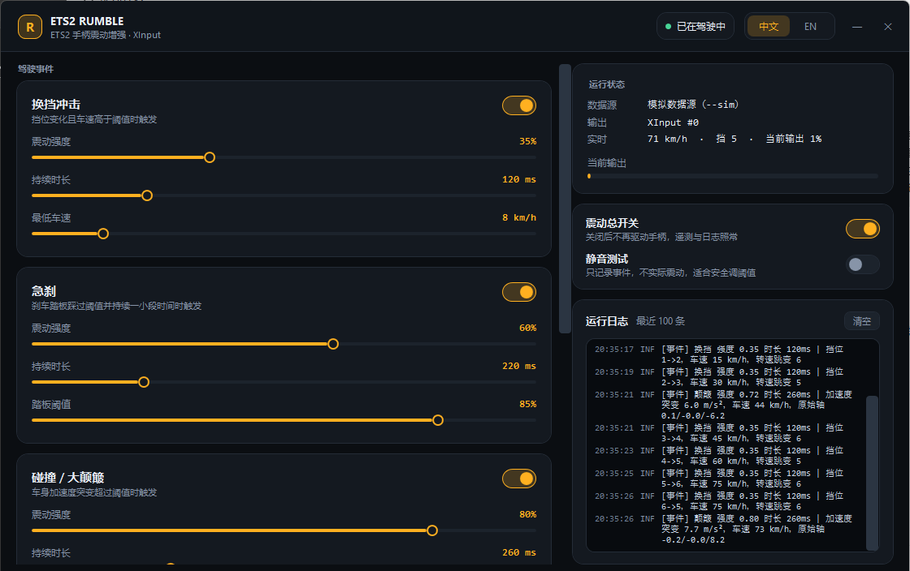
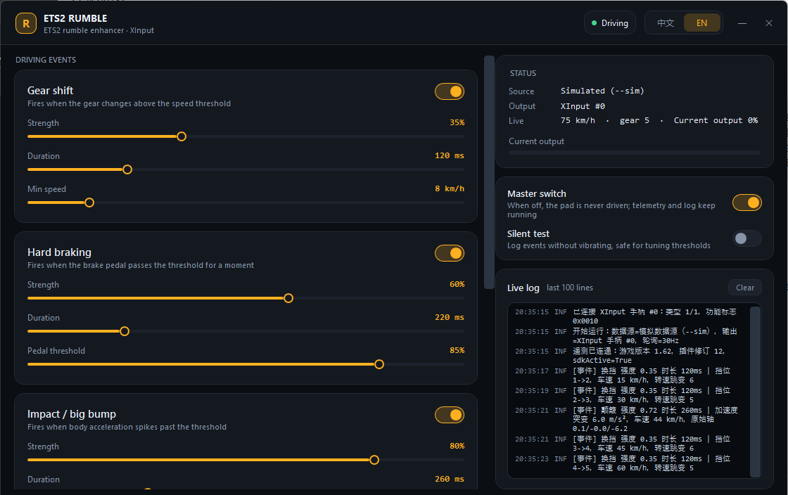

# ETS2 Rumble

外部程序 + 官方遥测插件，为《欧洲卡车模拟2》（Euro Truck Simulator 2）提供 XInput 握把马达震动增强。

An external Windows utility that adds XInput grip-motor rumble to **Euro Truck Simulator 2**, driven by the official SCS Telemetry SDK shared memory.

> **AI 生成声明 / AI-Generated Disclosure**
> 本项目的全部代码、文档与界面文案均由 AI 模型 **DeepSeel-V4.1-Flash** 生成，非人工编写。
> All source code, documentation and UI copy in this project were generated by the AI model **DeepSeel-V4.1-Flash**. This is not hand-written software.

---

## 目录 / Table of Contents

- [中文](#中文)
  - [1. 这是什么](#1-这是什么)
  - [2. 为什么必须用外部 exe，而不是创意工坊 Mod](#2-为什么必须用外部-exe而不是创意工坊-mod)
  - [3. 功能一览](#3-功能一览)
  - [4. 快速开始](#4-快速开始)
  - [5. 界面](#5-界面)
  - [6. 事件与默认参数](#6-事件与默认参数)
  - [7. 配置项](#7-配置项)
  - [8. 日志与校准](#8-日志与校准)
  - [9. 技术实现](#9-技术实现)
  - [10. 性能](#10-性能)
  - [11. 兼容性与已知问题](#11-兼容性与已知问题)
  - [12. 从源码构建](#12-从源码构建)
  - [13. 目录结构](#13-目录结构)
  - [14. 排障](#14-排障)
  - [15. 安全、隐私与多人游戏](#15-安全隐私与多人游戏)
  - [16. 许可与第三方](#16-许可与第三方)
- [English](#english)

---

## 中文

### 1. 这是什么

ETS2 Rumble 是一个 **Windows 桌面小工具**（.NET 8 / WPF）：

1. 游戏内由社区插件 `scs-sdk-plugin` 把遥测数据写入共享内存 `Local\SCSTelemetry`；
2. 本程序以 30Hz 只读这份内存，在换挡、急刹、碰撞/大颠簸、拨动开关、拉手刹时；
3. 通过 `XInputSetState` 让 Xbox 兼容手柄的**握把马达**震动。

它**不注入游戏、不修改游戏文件、不读写游戏内存之外的区域、不联网**。

### 2. 为什么必须用外部 exe，而不是创意工坊 Mod

这是本项目最核心的设计约束，也是很多人的第一个疑问。结论是：**在当前版本的 ETS2 上，用 Mod 实现动态震动在机制上不可能**，原因有四层：

**（1）ETS2 的 Mod 系统是纯数据，不含可执行代码**

创意工坊下发的 `.scs` 包（或 mod 文件夹）里只有定义文件、模型、纹理、音效和参数表。游戏启动时由游戏自己的代码去解释这些数据。Mod 里没有 DLL、没有脚本引擎入口，**没有任何办法调用 `XInputSetState` 这类系统 API**。

**（2）游戏内震动是"数据驱动的预设参数"，不是可编程接口**

游戏的震动系统读取的是预设参数（不同车型、路面、碰撞强度对应不同震动配置），Mod 只能改这些**参数值**。它无法做到"检测到挡位从 9 变到 8 且车速 25km/h，就在 120ms 内输出 35% 的马达强度"——因为这套判定与输出逻辑必须由**运行中的可执行代码**来完成。

**（3）创意工坊的下发路径不是插件路径**

- 创意工坊内容落在游戏的 mod 目录（形如 `文档\Euro Truck Simulator 2\mod`），由 mod 管理器加载；
- 而只有放在 **`游戏目录\bin\win_x64\plugins\`** 下的 DLL 才会被游戏在启动时作为插件加载，并弹出 "SDK has been activated"。

工坊包既不能写进 `bin\win_x64\plugins\`，也没有安装器权限去执行这个动作。

**（4）平台规则层面也不允许**

Steam 创意工坊是内容分发渠道，不接受可执行程序，也不允许通过工坊内容在玩家机器上启动外部进程。

**那官方数据从哪来？**

SCS 提供的唯一官方数据出口是 **Telemetry SDK**：插件 DLL 被游戏加载后，把遥测数据写进 Windows 文件映射对象。官方**没有**"网络端口"这种东西（社区 `ets2-telemetry-server` 的 `http://localhost:25555` 只是别人读同一份共享内存后包装出来的 HTTP 服务，不是原生机制）。

所以整条可行链路只有一条：

```
游戏进程
  └─ scs-telemetry.dll（官方 SDK 插件，放在 bin\win_x64\plugins\）
       └─ 共享内存 Local\SCSTelemetry
            └─ Ets2Rumble.exe（外部进程，只读）
                 └─ XInputSetState → 手柄握把马达
```

**重要副作用：必须关闭 Steam Input**

如果 Steam 的"为 Xbox 控制器启用 Steam 输入"开着，Steam 会接管 XInput 设备，外部程序调用 `XInputSetState` 会"调用成功但手柄不震"。

> Steam → 设置 → 控制器 → 为 Xbox 控制器启用 Steam 输入 → **关闭**

本程序不注入 Steam、不绕过 Steam Input，这一条只能由用户在 Steam 设置里完成。

### 3. 功能一览

| 事件 | 触发条件（默认） | 震动 |
|---|---|---|
| 换挡冲击 | 挡位变化且车速 ≥ 8 km/h，冷却 250ms | 35% / 120ms |
| 急刹 | 刹车踏板 ≥ 85% 且持续 80ms，冷却 600ms | 60% / 220ms |
| 碰撞 / 大颠簸 | 线加速度突变 ≥ 4.0 m/s²，冷却 700ms | 80% / 260ms |
| 转向灯 / 雨刮 / 大灯 / 远光 / 双闪 | 开关状态变化 | 30% / 150ms |
| 手刹（驻车制动） | 拉起、放下 | 45% / 600ms |

配套能力：

- 图形界面直接开关每个功能、拖动滑杆调强度/时长/阈值，**改完立即生效并自动保存**
- 实时日志面板（只保留最近 100 条，超出自动丢弃）
- 右上角中 / 英文界面切换（日志正文仍为中文，见"已知问题"）
- 游戏未启动、读档、暂停、退出时不会崩，自动等待并重连
- 程序退出或关窗口时把马达归零，不会留下一直震的状态

### 4. 快速开始

**第 1 步：安装官方遥测插件（只需一次）**

1. 到 [RenCloud/scs-sdk-plugin](https://github.com/RenCloud/scs-sdk-plugin)（`nlhans/ets2-sdk-plugin` 的维护分支）获取 `scs-telemetry.dll`（**64 位**版本）；
2. 打开游戏目录，例如 `E:\SteamLibrary\steamapps\common\Euro Truck Simulator 2\bin\win_x64\`；
3. 若没有 `plugins` 文件夹就新建一个，把 `scs-telemetry.dll` 放进去；
4. 启动游戏进存档，出现 **"SDK has been activated"** 提示即成功（每次启动都会弹，正常）。

> 本仓库**不附带**该 DLL：它是第三方 MIT 项目，且需要跟随游戏版本更新，请从上游获取。

**第 2 步：关闭 Steam Input**

Steam → 设置 → 控制器 → 关闭"为 Xbox 控制器启用 Steam 输入"。

**第 3 步：运行本程序**

双击 `Ets2Rumble.exe`（Release 里的 zip 解压后），界面出现即开始工作。切回游戏正常开即可。

**第 4 步（可选）：先验证链路**

```bat
Ets2Rumble.exe --probe --probe-seconds 15
```

能持续打印 `sdkActive=True` 和挡位、车速、加速度，说明数据链路通了。

### 5. 界面





- 左列：三张驾驶事件卡片（强度 / 时长 / 阈值滑杆）+ 小部件开关 + 手刹独立参数
- 右列：运行状态（数据源、手柄索引、车速挡位、当前输出电平）、震动总开关、静音测试、实时日志
- 右上角：中文 / EN 切换；窗口可拖动、双击标题栏最大化
- 底部：配置文件路径与保存状态

所有改动 500ms 防抖后写入 `config.json`，主循环读到新版本立即切换，**无需重启**。

### 6. 事件与默认参数

| 参数 | 默认 | 说明 |
|---|---|---|
| `shift.minSpeedKph` | 8 | 低于该车速换挡不触发（停车挂挡不震） |
| `shift.strength` / `durationMs` / `cooldownMs` | 0.35 / 120 / 250 | 强度、包络时长、冷却 |
| `brake.pedalThreshold` | 0.85 | 刹车踏板阈值（键盘一脚就是 1.0） |
| `brake.decelThresholdMps2` | 4.0 | 减速度阈值（备用判据） |
| `brake.holdMs` | 80 | 条件需持续多久才触发，过滤单帧抖动 |
| `brake.strength` / `durationMs` / `cooldownMs` | 0.60 / 220 / 600 | |
| `bump.thresholdMps2` | 4.0 | 动态加速度阈值（高通后三轴模长） |
| `bump.cargoDamageDelta` | 0.005 | 货物损伤增量（辅助证据，非必需） |
| `bump.strength` / `durationMs` / `cooldownMs` | 0.80 / 260 / 700 | |
| `switches.strength` / `durationMs` | 0.30 / 150 | 转向灯、雨刮、大灯、远光、双闪共用 |
| `switches.parkingBrakeStrength` / `parkingBrakeDurationMs` | 0.45 / 600 | 手刹单独一组 |

强度是 0~1，内部乘以增益后映射到 XInput 的 0~65535。

### 7. 配置项

完整 `config.json`（界面会自动维护，也可以手改，保存即热重载）：

```json
{
  "source": "shm",
  "loop": { "pollHz": 30, "staleTimeoutMs": 1000 },
  "shift":   { "enabled": true, "minSpeedKph": 8, "strength": 0.35, "durationMs": 120, "cooldownMs": 250 },
  "brake":   { "enabled": true, "pedalThreshold": 0.85, "decelThresholdMps2": 4.0, "holdMs": 80,
               "strength": 0.6, "durationMs": 220, "cooldownMs": 600 },
  "bump":    { "enabled": true, "thresholdMps2": 4.0, "cargoDamageDelta": 0.005, "minSpeedKph": 5,
               "strength": 0.8, "durationMs": 260, "cooldownMs": 700 },
  "switches": { "enabled": true, "blinkers": true, "wipers": true, "headlights": true,
                "highBeam": true, "hazardLights": true, "strength": 0.3, "durationMs": 150,
                "parkingBrake": true, "parkingBrakeStrength": 0.45, "parkingBrakeDurationMs": 600 },
  "output":  { "enabled": true, "controllerIndex": -1, "leftGain": 1.0, "rightGain": 1.0, "dryRun": false },
  "log":     { "enabled": true, "path": "logs/rumble.log", "verbose": false, "telemetrySampleMs": 0 },
  "ui":      { "language": "zh" }
}
```

| 键 | 作用 |
|---|---|
| `source` | `shm`（共享内存，唯一实现）。HTTP 回退为二期，未实现，不要改成 `http` |
| `output.enabled` | 震动总开关（界面里的"震动总开关"） |
| `output.dryRun` | 静音测试：只记录不震动 |
| `output.controllerIndex` | `-1` 自动找第一个手柄；`0..3` 指定索引 |
| `output.leftGain` / `rightGain` | 左右马达总增益 |
| `log.verbose` | 打开 Debug 统计（每 10 秒一行） |
| `log.telemetrySampleMs` | 遥测采样间隔，`200` 适合校准，`0` 关闭 |

### 8. 日志与校准

日志在 `logs/rumble.log`，超过 5MB 自动轮转为 `.1`。界面只显示最近 100 条。

```
21:30:12 [INF] [事件] 换挡 强度 0.35 时长 120ms | 挡位 2->3，车速 30 km/h，转速跳变 8
21:30:15 [INF] [事件] 颠簸 强度 0.63 时长 260ms | 加速度突变 5.0 m/s²，车速 44 km/h，原始轴 0.1/-0.0/-4.7
21:30:20 [INF] [事件] 手刹 强度 0.45 时长 600ms | 开
```

校准顺序建议：

1. 先开"静音测试"，确认每条事件都在该触发的时候触发、不该触发时不触发；
2. **一次只改一个数字**，开出去跑 10 分钟再判断；
3. 颠簸太频繁 → 调大 `bump.thresholdMps2`（4.0 → 6.0）；
4. 换挡太密 → 调大 `shift.cooldownMs`（250 → 450）；
5. 整体太轻 → 三个 `strength` 各加 0.1；小力度感知不到时，优先加时长（150 → 200ms）。

### 9. 技术实现

**数据链路**

`scs-sdk-plugin` 在游戏启动时由 SCS SDK 加载，创建 32KB 文件映射对象 `Local\SCSTelemetry`（源码定义：`SCS_PLUGIN_MMF_NAME = TEXT("Local\\SCSTelemetry")`）。本程序用 `MemoryMappedFile.OpenExisting` 只读打开，**每帧只读前 2048 字节**（覆盖到偏移 2000），30Hz 下约 60KB/s。

**结构体对齐**

插件的结构体 `scsTelemetryMap_t` 是**手工分区**排版：每个区有固定起点，区尾用 `char buffer_xx[n]` 补齐。C# 侧用 `[StructLayout(Pack = 1)]` 一一镜像，`bool` 一律写成 `byte`（C# 的 `bool` 默认按 4 字节封送，会整体错位），启动时用 `Marshal.OffsetOf` 逐项校验，不一致直接退出，绝不带错位去震动。

已核对的关键偏移（基址 0）：

| 字段 | 偏移 | 类型 | 说明 |
|---|---|---|---|
| `sdkActive` | 0 | byte | 插件已激活 |
| `paused` | 4 | byte | 游戏暂停/菜单 |
| `time` | 8 | uint64 | 帧时间戳，**微秒**（用于判数据新鲜度） |
| `version_minor` | 48 | uint32 | 遥测接口次版本 |
| `truck_i.gear` | 504 | int32 | >0 前进挡，0 空挡，<0 倒挡 |
| `truck_f.speed` | 948 | float | **m/s** |
| `truck_f.engineRpm` | 952 | float | 转速 |
| `truck_f.userBrake` | 964 | float | 刹车踏板 0~1 |
| `job_f.cargoDamage` | 1468 | float | 货物损伤 |
| `truck_b.parkBrake` | 1566 | byte | 手刹 |
| `truck_b.wipers` | 1577 | byte | 雨刮开关 |
| `truck_b.blinkerLeftActive` / `blinkerRightActive` | 1578 / 1579 | byte | 转向灯**拨杆状态** |
| `truck_b.blinkerLeftOn` / `blinkerRightOn` | 1580 / 1581 | byte | 转向灯**当前是否点亮**（会随闪烁翻转，不用） |
| `truck_b.lightsBeamLow` / `lightsBeamHigh` | 1583 / 1584 | byte | 近光 / 远光 |
| `truck_b.lightsHazard` | 1588 | byte | 双闪 |
| `truck_fv.lv_accelerationX/Y/Z` | 1868 / 1872 / 1876 | float | 名字叫加速度，**实际是车身线速度** |
| `truck_fv.accelerationX/Y/Z` | 1892 / 1896 / 1900 | float | 车身线加速度 m/s² |

**源码里核对出的五个坑**（都是"按名字猜就会错"的地方）

1. `lv_acceleration*` 注册的通道是 `local_linear_velocity`（线速度），**不是**加速度；
2. SDK **没有碰撞通道**，只有货物损伤。所以"碰撞/大颠簸"是从加速度突变推断的，任何声称"读取碰撞事件"的实现都在编；
3. `speed` 单位是 **m/s**，不是 km/h；
4. `lightsHazard` 只在 `version_minor >= 17` 时注册（ETS2 1.41+），老版本取不到；
5. `blinker*Active` 是拨杆开关状态（SDK 原文明确说它不随灯闪烁变化），`blinker*On` 才是灯亮灭。用后者会导致转向灯每闪一下震一次。

**事件判定**

- 加速度判据先做高通（减去慢速基线）再取三轴模长，因此**不依赖轴的指向**，也不受重力是否包含在原始值里的影响；
- 所有事件共用"包络混合器"：按峰值起振、按时长平方衰减，多事件重叠取最大值，避免马达"咔哒"一下不可感知；
- 冷却时间按事件类型独立计时；游戏暂停/时间戳超过 1000ms 未更新时清空所有震动。

**扳机震动为什么不做**

XInput 标准接口只能控制两个握把马达。社区实现 X1nput 的做法是 hook `xinput1_3.dll`，在钩子里把普通震动转成扳机震动请求，再通过底层 HID 或 `Windows.Gaming.Input` 发送。本项目 **MVP 明确不做**：它需要注入/hook，属于高风险区域，与"不注入游戏、不修改游戏"的设计目标冲突。若要做，会作为可选模块单独发布。

### 10. 性能

| 模式 | 内存 | CPU | 说明 |
|---|---|---|---|
| 图形界面 | 约 220–230 MB | 单核约 1% | WPF 运行时占大头 |
| `--console` | 约 30 MB | 单核 <1% | 无界面，功能一致 |

- 轮询默认 30Hz，可配 5–120Hz；单帧只读 2KB，无 JSON、无磁盘 IO；
- 日志由后台线程批量落盘（每秒最多一次），不阻塞主循环；
- 界面状态 4Hz 轮询快照，日志 8Hz 批量刷新，均与引擎线程解耦。

### 11. 兼容性与已知问题

- **开发与实测环境**：Windows 11 + ETS2 `1.62.3.3` + `scs-sdk-plugin` `1.12.1`，实测可用。
- **版本漂移风险**：插件基于旧 SDK。游戏升级后若 SCS 改动遥测接口，可能需要换维护分支或自行编译插件；本程序会因偏移自检失败而拒绝运行，不会乱震。
- **Steam Input**：必须关闭，否则 `XInputSetState` 无效（表现为日志有事件、手柄不震）。
- **第三方手柄**：只保证 XInput 模式；DInput 模式、部分蓝牙链路可能不稳。蓝牙未充分验证。
- **英文界面下日志正文仍为中文**：日志与事件文本由引擎直接生成，未做翻译；界面标签、状态、按钮已全部切换。
- **没有真正的碰撞事件**：见技术实现第 2 条，颠簸/碰撞是加速度推断。
- **不支持扳机震动**：见上文。
- **创意工坊不可行**：见第 2 节。

### 12. 从源码构建

需要 [.NET 8 SDK](https://dotnet.microsoft.com/download/dotnet/8.0)：

```bat
dotnet build -c Release
dotnet publish -c Release -r win-x64 --self-contained true ^
  -p:PublishSingleFile=true -p:EnableCompressionInSingleFile=true ^
  -p:IncludeNativeLibrariesForSelfExtract=true -p:DebugType=none -o dist
```

产物是单文件 `dist\Ets2Rumble.exe`（约 63MB），目标机器不需要安装 .NET。

零第三方 NuGet 依赖，只使用 BCL（`MemoryMappedFiles`、`System.Text.Json`、WPF）与系统 DLL（`xinput1_4.dll`，缺失时回退 `xinput1_3.dll` / `xinput9_1_0.dll`）。

### 13. 目录结构

```
.
├─ Ets2Rumble.csproj
├─ config.json                  默认配置（随 exe 一起分发）
├─ src/
│  ├─ Program.cs                入口：默认开界面，--console/--probe 走控制台
│  ├─ App/RumbleEngine.cs       30Hz 主循环：采样→检测→混合→输出
│  ├─ Config/AppConfig.cs       配置模型（带默认值）
│  ├─ Config/ConfigStore.cs     加载/热重载/保存（防抖、容错）
│  ├─ Telemetry/ITelemetrySource.cs   数据源接口（预留 HTTP 回退）
│  ├─ Telemetry/ScsLayout.cs          共享内存结构体镜像 + 偏移自检
│  ├─ Telemetry/SharedMemorySource.cs Local\SCSTelemetry 只读实现
│  ├─ Telemetry/SimulatedSource.cs     模拟数据源（--sim，便于调界面）
│  ├─ Events/EventDetector.cs   事件判定与冷却
│  ├─ Events/PulseMixer.cs      包络混合
│  ├─ Output/XInputOutput.cs    XInput 握把马达输出
│  ├─ Logging/Logger.cs         异步批量日志
│  └─ Gui/                      WPF 界面（主题、双语资源、主窗口）
└─ docs/
   ├─ 安装与校准.md              详细安装与手感校准（中文）
   └─ images/                   界面截图
```

### 14. 排障

| 现象 | 原因 | 处理 |
|---|---|---|
| 界面显示"等待游戏数据" | 游戏没开 / 没进存档 / 插件没装 | 装插件并进一次驾驶舱 |
| 有日志但手柄不震 | Steam Input 接管 / 手柄在 DInput 模式 | 关闭 Steam Input；手柄切 XInput |
| 程序启动即退出 | 结构体偏移自检失败（游戏改了接口） | 查看 `logs/rumble.log`，换插件版本 |
| 每 2 秒一条"未检测到手柄" | 手柄未连接 | 接上手柄，或忽略（只提示一次） |
| 英文界面日志仍是中文 | 已知限制 | 见第 11 节 |

### 15. 安全、隐私与多人游戏

- 只读打开共享内存，**不写游戏内存、不注入、不 hook 系统 DLL、不修改任何游戏文件**；
- 不联网、不收集任何数据、不上传日志；
- 使用第三方联机平台前，请自行确认该平台的规则；本项目不修改游戏逻辑，但仍不对平台判定作任何保证。

### 16. 许可与第三方

- 本项目代码：**MIT**，见 [LICENSE](LICENSE)。
- 数据来源：[scs-sdk-plugin](https://github.com/RenCloud/scs-sdk-plugin)（MIT，Copyright (c) 2014 Hans；`nlhans/ets2-sdk-plugin` 的维护分支）。**本仓库不包含、不重新分发其 DLL**，请从上游获取。
- SCS Telemetry SDK、Euro Truck Simulator 2 及其名称、商标归 **SCS Software** 所有。本项目与 SCS Software **无任何隶属或背书关系**，仅为第三方玩家工具。
- 详见 [THIRD-PARTY-NOTICES.md](THIRD-PARTY-NOTICES.md)。

---

## English

### What it is

ETS2 Rumble is a small Windows desktop app (.NET 8 / WPF) that:

1. reads the telemetry shared memory `Local\SCSTelemetry` written by the community plugin `scs-sdk-plugin`;
2. detects gear shifts, hard braking, impacts/big bumps and dashboard switch changes at 30 Hz;
3. drives the **grip motors** of an Xbox-compatible controller through `XInputSetState`.

It does **not** inject into the game, modify game files, write to game memory, or use the network.

### Why an external EXE instead of a Workshop mod

This is the key design constraint, and it is not a matter of preference:

1. **ETS2 mods are data-only.** A `.scs` package contains definitions, models, textures, sounds and parameter tables. There is no executable code and no scripting entry point, so a mod cannot call `XInputSetState` or any Win32 API.
2. **In-game vibration is data-driven presets.** Mods can change preset values, but they cannot implement "if gear changed from 9 to 8 at 25 km/h, output 35% motor power for 120 ms". That requires running code.
3. **The Workshop does not install plugins.** Workshop content lands in the mod directory and is loaded by the mod manager. Only DLLs placed in `<game>\bin\win_x64\plugins\` are loaded as SDK plugins at startup.
4. **Platform rules.** The Workshop is a content channel; it does not accept executables and does not allow starting external processes.

SCS exposes exactly one official data path: the **Telemetry SDK**, i.e. a plugin DLL writing to a file mapping object. There is **no official network port** — the popular `http://localhost:25555` endpoint is a community wrapper around the same shared memory.

```
Game process
  └─ scs-telemetry.dll (in bin\win_x64\plugins\)
       └─ shared memory Local\SCSTelemetry
            └─ Ets2Rumble.exe (external, read-only)
                 └─ XInputSetState → grip motors
```

**Steam Input must be disabled**: Steam → Settings → Controller → "Steam Input for Xbox controllers" → **Off**. Otherwise Steam owns the XInput device and `XInputSetState` silently does nothing.

### Features

| Event | Default trigger | Rumble |
|---|---|---|
| Gear shift | gear changed, speed ≥ 8 km/h, 250 ms cooldown | 35% / 120 ms |
| Hard braking | pedal ≥ 85% for 80 ms, 600 ms cooldown | 60% / 220 ms |
| Impact / big bump | filtered accel spike ≥ 4.0 m/s², 700 ms cooldown | 80% / 260 ms |
| Turn signals / wipers / headlights / high beam / hazards | switch state change | 30% / 150 ms |
| Parking brake | applied / released | 45% / 600 ms |

Plus: a dark-themed GUI with per-event toggles and sliders (applied instantly, auto-saved), a 100-line live log, Chinese/English UI switch, graceful waiting/reconnect, and motor zeroing on exit.

### Install

1. Get `scs-telemetry.dll` (64-bit) from [RenCloud/scs-sdk-plugin](https://github.com/RenCloud/scs-sdk-plugin) and copy it to `<game>\bin\win_x64\plugins\` (create the folder if needed). The game shows "SDK has been activated" on startup — that is expected.
2. Disable Steam Input (see above).
3. Run `Ets2Rumble.exe`. Optional check: `Ets2Rumble.exe --probe --probe-seconds 15`.

The plugin DLL is **not** bundled here: it is a third-party MIT project and must be updated independently.

### GUI


Left: three driving-event cards (strength / duration / threshold) plus switch toggles and separate handbrake settings.
Right: status (source, controller index, speed, gear, output level), master switch, silent test, live log.
Top-right: 中文 / EN. Bottom: config path and save state.

### CLI

| Argument | Meaning |
|---|---|
| *(none)* | Open the GUI |
| `--sim` | GUI with a simulated data source (no game required) |
| `--console` | Headless console mode (~30 MB RAM instead of ~225 MB) |
| `--probe --probe-seconds 15` | Print telemetry only, no rumble |
| `--no-output` | Log only, never drive the motors |
| `--config <path>` | Use another config file |

### Technical notes

- Shared memory: `Local\SCSTelemetry`, 32 KB, opened read-only; only the first 2 KB are read each frame (~60 KB/s at 30 Hz).
- The plugin's struct is hand-partitioned with padding arrays. The C# mirror uses `[StructLayout(Pack = 1)]` and `byte` instead of `bool` (C#'s default `bool` marshalling is 4 bytes and would shift every field). All offsets are verified with `Marshal.OffsetOf` at startup; a mismatch aborts instead of rumbling wrongly.
- Verified pitfalls: `lv_acceleration*` actually carries **linear velocity**; there is **no collision channel** (only cargo damage); `speed` is **m/s**; `lightsHazard` is registered only when `version_minor >= 17`; use `blinker*Active` (switch state), never `blinker*On` (lamp state, toggles every blink).
- Bump detection high-passes each axis against a slow baseline and takes the 3-axis magnitude, so it is independent of axis orientation and gravity.
- Trigger (impulse) rumble is **not implemented**: standard XInput cannot address trigger motors. X1nput achieves it by hooking `xinput1_3.dll` and re-sending via HID / `Windows.Gaming.Input`; that conflicts with the no-injection design and is left for a future optional module.

### Performance

| Mode | Memory | CPU |
|---|---|---|
| GUI | ~220–230 MB | ~1% of one core |
| `--console` | ~30 MB | <1% of one core |

No JSON parsing on the hot path, no synchronous disk I/O; logs are flushed by a background thread.

### Compatibility and known issues

- Tested on Windows 11 with ETS2 `1.62.3.3` and `scs-sdk-plugin` `1.12.1`.
- Version drift: if SCS changes the telemetry layout, the offset self-check will refuse to run until the plugin/mirror is updated.
- Steam Input must be off. Third-party pads are only supported in XInput mode; Bluetooth is not fully validated.
- In English UI mode the log text remains Chinese (engine diagnostics are not translated).
- "Impact" is inferred from acceleration; the SDK has no collision event.
- Steam Workshop distribution is impossible for the reasons above.

### Build

Requires the [.NET 8 SDK](https://dotnet.microsoft.com/download/dotnet/8.0):

```bat
dotnet publish -c Release -r win-x64 --self-contained true ^
  -p:PublishSingleFile=true -p:EnableCompressionInSingleFile=true ^
  -p:IncludeNativeLibrariesForSelfExtract=true -p:DebugType=none -o dist
```

No third-party NuGet packages. Only the BCL (`MemoryMappedFiles`, `System.Text.Json`, WPF) and system DLLs (`xinput1_4.dll`, falling back to `xinput1_3.dll` / `xinput9_1_0.dll`).

### Privacy and safety

Read-only shared memory access; no memory writes, no injection, no hooks, no network, no telemetry, no log uploads. Check the rules of any multiplayer platform you use; no guarantee is made about their enforcement decisions.

### License and credits

- Project code: **MIT** (see [LICENSE](LICENSE)).
- Data source: [scs-sdk-plugin](https://github.com/RenCloud/scs-sdk-plugin) — MIT, Copyright (c) 2014 Hans. Not bundled or redistributed here.
- SCS Telemetry SDK, Euro Truck Simulator 2 and related marks belong to **SCS Software**. This project is unofficial and not affiliated with or endorsed by SCS Software.
- See [THIRD-PARTY-NOTICES.md](THIRD-PARTY-NOTICES.md).

### AI disclosure

All code, documentation and UI copy were generated by the AI model **DeepSeel-V4.1-Flash**. This is not hand-written software.
